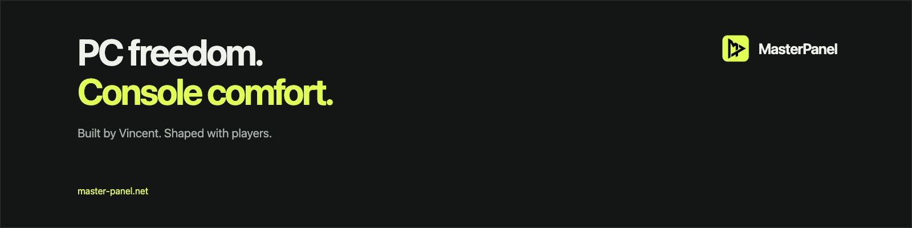
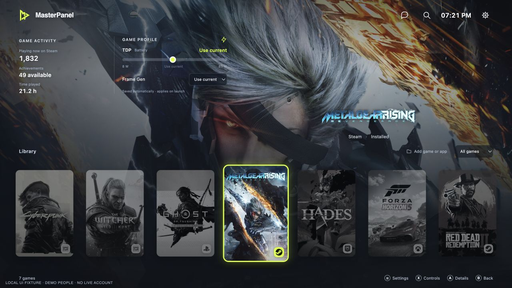
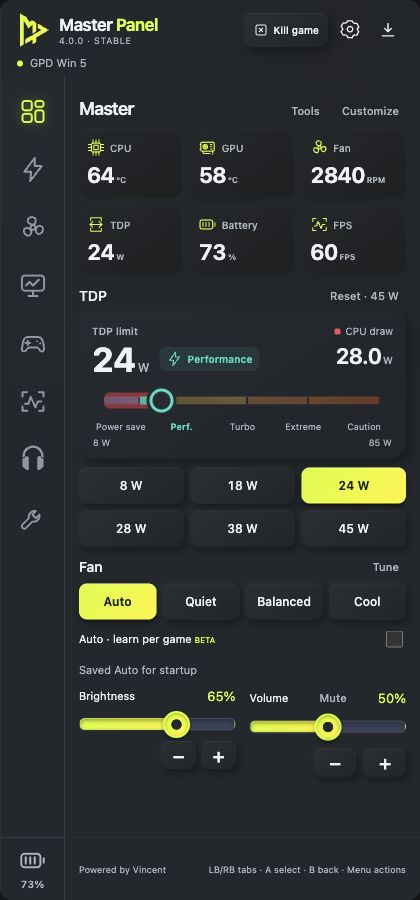
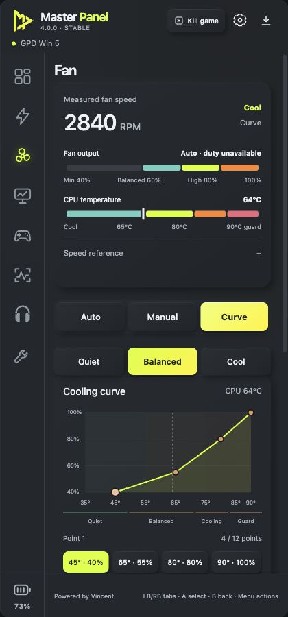

# MasterPanel

A console-like home for **Windows handhelds**. Fullscreen game library, quick Panel controls and an Xbox Game Bar Widget, built around playing with a controller.

**[Download for Windows](https://github.com/soullegacyvn-ux/Master-Panel/releases/latest)** · **[Join Discord](https://discord.gg/n2fD2jvjvz)** · [Website](https://master-panel.net/) · [Patreon](https://www.patreon.com/c/masterpanel)

## One app, three ways in

- **Fullscreen Home:** browse your game library, open game details and keep per-game preferences close at hand.
- **Panel:** reach supported power, cooling, display and controller controls beside your game.
- **Xbox Game Bar Widget:** open your shared controls through Win+G.

One shared control engine connects the interfaces and saved settings. The aim is a light, fast experience that feels at home on a handheld.

*Product preview with sample data. The current stable download includes Panel and Widget; fullscreen Home is in development. Features and hardware tuning vary by release and supported device profile. Check the latest release notes before installing.*

## Controls, close at hand

Adjust supported TDP limits, customize six presets and compare the limit with actual CPU power draw. Pick fan profiles or a custom curve, tune display settings, map supported buttons and save profiles.

Optional RTSS, compatible FxSound and Windows Lossless Scaling controls bring your existing tools into the same place. Lossless Scaling is purchased separately on Steam.

See Panel and cooling previews

<table><tr><td width="50%"></td><td width="50%"></td></tr><tr><td align="center">Panel</td><td align="center">Cooling</td></tr></table>

## Get started

1. Choose the Windows **Setup EXE** under Assets in the [latest stable release](https://github.com/soullegacyvn-ux/Master-Panel/releases/latest).
2. Exit an older Panel from its tray menu before running Setup. A normal upgrade keeps user settings and installs the matching interfaces included in that release.
3. Use the installed shortcuts. On supported devices, the physical swap button opens Panel. For the Widget: **Win+G → Widgets → Master Panel**.

Windows 11 x64 is the intended platform. **WebView2** displays the interface; **PawnIO** enables supported hardware controls, which require elevated access. **Settings → Components** links to official installers. The stable 4.0.0 hardware controls target GPD Win 5; a broader product direction does not enable unverified hardware writes on other devices.

The installer has no commercial code-signing certificate. Widget setup uses its included self-signed public certificate and local loopback access. See the release notes for details.

## Join the community

**[Join MasterPanel on Discord](https://discord.gg/n2fD2jvjvz)** to ask a question, compare game settings or help investigate a bug.

- **#game-profiles:** share your device, game, app version, power source and settings you actually tried.
- **#help:** questions about setup and everyday use.
- **#bug-reports:** what you expected, what happened and how to reproduce it.

**Settings → Report a problem** creates a local diagnostic ZIP with no automatic upload. Review it and send it by email when requested. Keep credentials and personal information out of public reports.

A GitHub star helps other players find the project. [Follow or support development on Patreon](https://www.patreon.com/c/masterpanel). The Windows download and Discord remain open to everyone.

## Guides

[Quick start](QUICK-START.txt) · [Release notes](RELEASE-NOTES.md) · [Stability](STABILITY.md) · [Tools overview](TOOLS-OVERVIEW.md) · [4.0.0 validation](VALIDATION-4.0.0.txt)

Older reports are in [docs/history](docs/history/). Maintainer notes are in [docs/maintenance](docs/maintenance/). They describe their named versions, not current feature promises. Game, temperature, power source and firmware affect results; no preset guarantees an FPS increase.

## Licenses and notices

See [LICENSE](LICENSE) and [third-party notices](NOTICE.md). This public repository contains release documentation and promotional images. The application build workspace is separate.

**Powered by Vincent** · [mythvietnamese@gmail.com](mailto:mythvietnamese@gmail.com)
