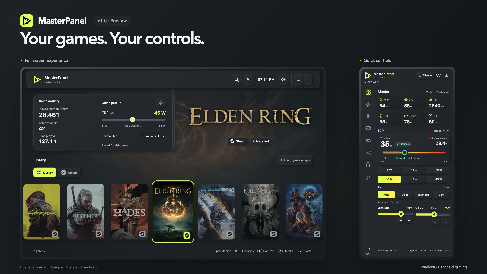
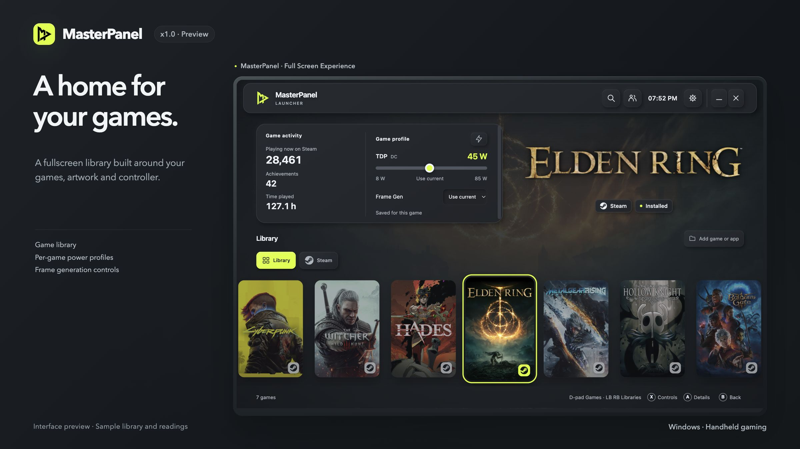
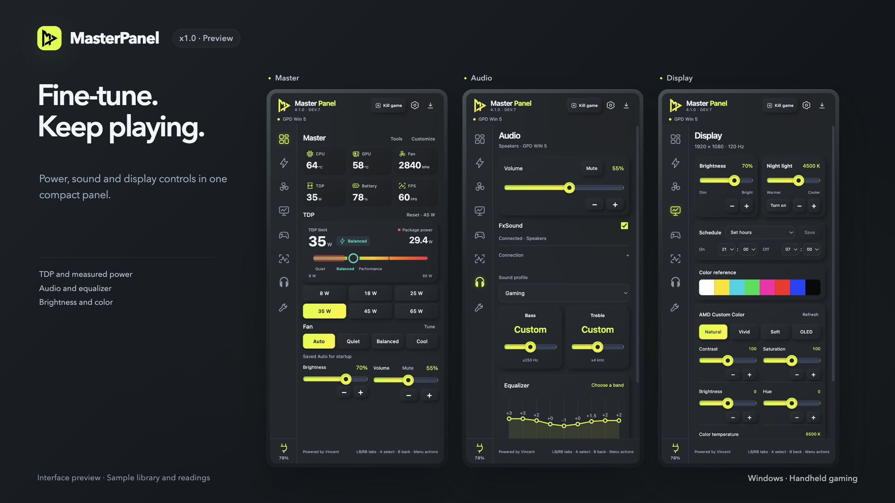

# MasterPanel

Your game library and handheld controls, together on Windows.

**[Download stable 4.0.0](https://github.com/soullegacyvn-ux/Master-Panel/releases/latest)** · **[Join Discord](https://discord.gg/n2fD2jvjvz)** · **[Quick start](docs/quick-start.txt)**

**MasterPanel x1.0 is in development preview.** The images below show the upcoming experience. The current public download remains 4.0.0 with Panel and Game Bar Widget; a new installer will be published after testing.

## Why MasterPanel

The **x1.0 development preview** brings the gaming experience together:

- **Performance-focused FSE.** Tune TDP, cooling and per-game profiles to optimize gameplay. FPS gains vary by game, device and settings.
- **Compact controls.** Panel and Widget share one control engine and saved settings, with the controls you need close at hand.
- **Device-aware support.** The preview includes GPD Win 5 and ONEXPLAYER X2 Mini Pro profiles. Available controls and hardware validation vary by device and firmware.
- **Easy to navigate.** Browse games and adjust settings through interfaces designed for controller, touch and desktop use.
- **Community inside FSE.** Meet MasterPanel players, manage friends and send invitations to play together from the launcher. Steam and Discord integrations are also in preview.
- **More to come.** Planned improvements cover the library, supported hardware and Community. Development priorities will follow testing and player feedback.

## One app, three interfaces

| Interface | Purpose |
| --- | --- |
| **Launcher** | Browse your game library in a controller-friendly fullscreen home. |
| **Panel** | Reach supported power, cooling, display, audio and controller settings. |
| **Game Bar Widget** | Open shared controls while playing with **Win+G**. |

Panel and Widget use the same control engine and saved settings. Hardware features depend on the device and firmware.

## Install

1. Download the **Setup EXE** from the [stable release](https://github.com/soullegacyvn-ux/Master-Panel/releases/latest).
2. Exit the older Panel from its tray menu, then run Setup. A normal upgrade keeps your preferences.
3. Open Panel from its shortcut, or use **Win+G → Widgets → Master Panel**.

Windows 11 x64 is the intended platform. Stable 4.0.0 hardware controls target **GPD Win 5**. WebView2, Xbox Game Bar and PawnIO support the relevant components; see the [quick start](docs/quick-start.txt).

The upcoming Windows gaming-home integration is a developer preview. Microsoft production authorization is pending.

## Community and support

[Join MasterPanel on Discord](https://discord.gg/n2fD2jvjvz) for help, game profiles and development updates. For a bug report, include the app version, device, power source and steps to reproduce it.

**Settings → Report a problem** creates a local diagnostic ZIP. Review it before sharing; reports are not uploaded automatically.

[Guides](docs/README.md) · [4.0.0 release notes](docs/releases/4.0.0.md) · [Validation](docs/validation/VALIDATION-4.0.0.txt)

## License

See [LICENSE](LICENSE) and [third-party notices](NOTICE.md). This public repository contains release documentation and product images; the application build workspace is separate.

**Powered by Vincent** · [Contact](mailto:mythvietnamese@gmail.com)
